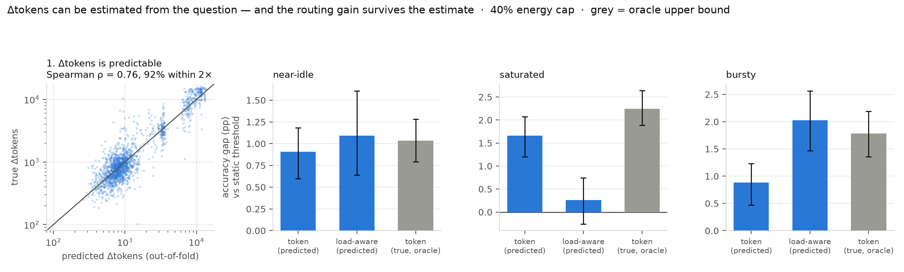

# E10 — estimating the token cost, and whether the routing gain survives it

E8 §3 found that the ingredient earning accuracy at a matched energy cap is the **per-query token count**, not live load. But Δtokens is not observable before generating, so that gain was an oracle result. This asks whether it can be earned honestly.

## 1. Is Δtokens predictable from the question text?

Out-of-fold, 5-fold CV. A price only needs to be right to within a *factor*, so the error measure is the ratio, not the token count.

|model|Spearman ρ|R² (log)|median ratio error|within 2×|
|--|--|--|--|--|
|constant E[dtok]|+nan|-0.414|3.04×|19%|
|prompt length only|+0.532|+0.622|1.47×|72%|
|TF-IDF + ridge|+0.761|+0.837|1.25×|92%|

**Contrast with RQ3.** Predicting whether thinking will *flip* an answer means predicting the model's own competence, and that sits at chance within a fixed topic (`results/pooled/WHY_ROUTING_FAILS.md`). Predicting *how long* the reasoning will run is a property of the question, not of the model's competence — a different and easier target, and the one this policy actually needs.

## 2. Does the routing gain survive the estimate?

Same protocol as E8: matched energy, dense per-family grids, 12 held-out traces × 500 queries, paired bootstrap CIs. `(true dtok)` rows are the oracle upper bound.

**near-idle**

|cap|policy|accuracy|think|Wh|p95|gap vs static, 95% CI|
|--|--|--|--|--|--|--|
|25%|static-tau|0.8456|2%|117.7|16 s|—|
|25%|token (true dtok)|0.8507|5%|117.7|23 s|+0.51pp [+0.28, +0.74]|
|25%|token (PREDICTED)|0.8506|4%|117.2|20 s|+0.50pp [+0.22, +0.84]|
|25%|load-aware (const)|0.8483|3%|116.8|28 s|+0.28pp [-0.47, +1.15]|
|25%|load-aware (PREDICTED)|0.8481|4%|117.7|21 s|+0.25pp [-0.08, +0.63]|
|25%|load-aware (true dtok)|0.8510|5%|117.6|22 s|+0.54pp [+0.23, +0.88]|
|25%|random@rate|0.8359|4%|117.8|17 s|-0.97pp [-1.33, -0.61]|
|25%|oracle|0.8723|5%|117.4|21 s|+2.67pp [+2.36, +2.98]|
|40%|static-tau|0.8500|3%|128.6|18 s|—|
|40%|token (true dtok)|0.8603|7%|128.6|39 s|+1.03pp [+0.79, +1.28]|
|40%|token (PREDICTED)|0.8591|7%|128.2|39 s|+0.91pp [+0.60, +1.18]|
|40%|load-aware (const)|0.8614|5%|128.5|48 s|+1.14pp [+0.20, +2.12]|
|40%|load-aware (PREDICTED)|0.8609|6%|128.3|34 s|+1.09pp [+0.64, +1.61]|
|40%|load-aware (true dtok)|0.8620|7%|128.6|38 s|+1.20pp [+0.84, +1.59]|
|40%|random@rate|0.8383|8%|128.4|19 s|-1.17pp [-1.64, -0.69]|
|40%|oracle|0.8876|7%|128.5|32 s|+3.76pp [+3.37, +4.15]|

**saturated**

|cap|policy|accuracy|think|Wh|p95|gap vs static, 95% CI|
|--|--|--|--|--|--|--|
|25%|static-tau|0.8441|2%|20.6|17 s|—|
|25%|token (true dtok)|0.8932|12%|20.6|86 s|+4.91pp [+4.26, +5.62]|
|25%|token (PREDICTED)|0.8638|8%|20.6|54 s|+1.98pp [+1.56, +2.48]|
|25%|load-aware (const)|0.8415|2%|20.6|25 s|-0.26pp [-1.00, +0.66]|
|25%|load-aware (PREDICTED)|0.8630|8%|20.6|48 s|+1.89pp [+1.38, +2.49]|
|25%|load-aware (true dtok)|0.8764|10%|20.6|63 s|+3.23pp [+2.69, +3.84]|
|25%|random@rate|0.8362|5%|20.3|19 s|-0.79pp [-1.12, -0.46]|
|25%|oracle|0.9151|10%|20.6|76 s|+7.10pp [+6.44, +7.81]|
|40%|static-tau|0.8887|9%|25.8|121 s|—|
|40%|token (true dtok)|0.9111|16%|25.8|147 s|+2.24pp [+1.88, +2.64]|
|40%|token (PREDICTED)|0.9052|14%|25.8|138 s|+1.66pp [+1.20, +2.08]|
|40%|load-aware (const)|0.8726|7%|25.8|78 s|-1.61pp [-2.94, -0.40]|
|40%|load-aware (PREDICTED)|0.8912|12%|25.6|99 s|+0.26pp [-0.26, +0.74]|
|40%|load-aware (true dtok)|0.8968|14%|25.8|104 s|+0.82pp [+0.35, +1.27]|
|40%|random@rate|0.8593|29%|25.8|74 s|-2.93pp [-3.53, -2.38]|
|40%|oracle|0.9366|13%|25.7|141 s|+4.79pp [+4.34, +5.27]|

**bursty**

|cap|policy|accuracy|think|Wh|p95|gap vs static, 95% CI|
|--|--|--|--|--|--|--|
|25%|static-tau|0.8537|3%|163.5|20 s|—|
|25%|token (true dtok)|0.8734|10%|164.3|53 s|+1.98pp [+1.59, +2.39]|
|25%|token (PREDICTED)|0.8655|9%|163.6|49 s|+1.18pp [+0.86, +1.52]|
|25%|load-aware (const)|0.8738|8%|164.6|75 s|+2.02pp [+1.39, +2.63]|
|25%|load-aware (PREDICTED)|0.8758|10%|164.4|67 s|+2.22pp [+1.62, +2.78]|
|25%|load-aware (true dtok)|0.8789|10%|164.5|65 s|+2.53pp [+1.96, +3.05]|
|25%|random@rate|0.8429|13%|164.2|23 s|-1.08pp [-1.56, -0.59]|
|25%|oracle|0.8993|9%|164.2|44 s|+4.57pp [+4.05, +5.08]|
|40%|static-tau|0.8753|7%|214.4|55 s|—|
|40%|token (true dtok)|0.8932|12%|214.6|72 s|+1.78pp [+1.36, +2.19]|
|40%|token (PREDICTED)|0.8842|11%|214.4|66 s|+0.88pp [+0.47, +1.23]|
|40%|load-aware (const)|0.8911|12%|214.9|120 s|+1.58pp [+1.07, +2.09]|
|40%|load-aware (PREDICTED)|0.8956|16%|214.4|103 s|+2.03pp [+1.47, +2.57]|
|40%|load-aware (true dtok)|0.8985|16%|214.5|97 s|+2.32pp [+1.74, +2.89]|
|40%|random@rate|0.8512|21%|214.9|37 s|-2.41pp [-2.94, -1.93]|
|40%|oracle|0.9205|11%|214.0|73 s|+4.52pp [+4.05, +4.99]|

*Repro: `python scripts/e10_dtok_predictability.py` (CPU).*
