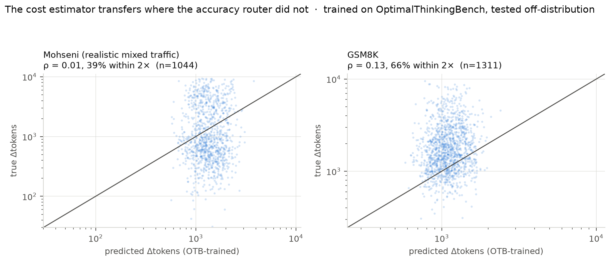

# E10b — does the token-cost estimator transfer, where the accuracy router did not?

The project's strongest negative result (RQ3) is that a text router trained on OptimalThinkingBench scores AUC 0.895 at home and **0.505–0.521 — chance — on Mohseni's realistic mixed traffic**. The explanation was mechanical: *will thinking flip this answer* is a question about the model's competence, and competence is not written in the query text.

E10 showed the quantity the winning policy actually needs is a different one — *how many tokens will thinking cost* — which is a property of the **question**. If that distinction is real and not a re-labelling, the cost estimator must survive the transfer that destroyed the accuracy router. Same training set, same held-out datasets.

|target|n|true mean Δtok|OTB→target ρ|within 2×|constant est. within 2×|IN-DOMAIN CV ρ|in-domain within 2×|
|--|--|--|--|--|--|--|--|
|Mohseni (realistic mixed traffic)|1044|1862|+0.006|39%|28%|+0.694|65%|
|Mohseni (realistic mixed traffic) — Nectar|512|891|+0.178|36%|16%|—|—|
|Mohseni (realistic mixed traffic) — WildChat-filtered|269|1240|+0.051|57%|23%|—|—|
|Mohseni (realistic mixed traffic) — Big-Math-RL|260|4394|+0.002|25%|57%|—|—|
|GSM8K|1311|2079|+0.131|66%|67%|+0.245|77%|
|GSM8K — gsm8k|1311|2079|+0.131|66%|67%|—|—|

`constant est. within 2×` is the honest reference: what predicting one number — the OTB mean Δtokens, which is what `src/router.py` ships by default — achieves on the same queries. `IN-DOMAIN CV ρ` trains the same estimator *on the target dataset itself*, 5-fold. That column is the diagnostic: it separates a transfer failure from an absent signal.

**Truncation had to be removed first.** 39% of Mohseni's no-think generations hit the token cap (`finish_reason='length'`). A truncated length is a cap, not a measurement, and it censors the very quantity being predicted. Those 762 queries are excluded; the numbers before exclusion were meaningfully different, so this is not a cosmetic filter.

## Reading — the asymmetry is about LEARNABILITY, not zero-shot transfer

**Zero-shot transfer fails.** An OTB-trained cost estimator is worth nothing on Mohseni (ρ = +0.006). It learned OptimalThinkingBench's topics and templates, exactly as the accuracy router did. On this axis the two are alike, and any claim that cost estimation is 'just easier' has to be retracted at the zero-shot level.

**But in-domain, the two targets are not alike at all — and this is the finding.**

|target quantity|trained and tested on Mohseni|verdict|
|--|--|--|
|*will thinking flip this answer?* (RQ3)|AUC **0.568–0.589** — best of 3 feature spaces × 5 classifiers, a mutual-information ceiling|the signal is **not in the text**|
|*how many tokens will thinking cost?* (E10b)|Spearman **+0.694**|the signal **is in the text**; only transfer fails|

So the honest statement is: **the benefit of thinking is not learnable from query text even with in-domain training; its cost is.** The cost model just has to be trained on the traffic it will serve, rather than borrowed from a benchmark.

**That is a mild deployment requirement, because Δtokens labels are free.** Every request a production server answers reveals its own generation length — the cost model is self-supervising and can be retrained continuously on live traffic. Accuracy labels are not free: knowing whether thinking would have flipped an answer requires ground truth and a counterfactual second generation. The two quantities differ not only in how learnable they are, but in whether an operator can ever obtain labels for them at all.

**GSM8K is the informative null.** Its in-domain ρ is only +0.245 — but it is a homogeneous grade-school-math set whose Δtokens barely varies (a single constant is already within 2× for 67% of it). There is little spread to rank and correspondingly little to gain, which is the same 'within a fixed topic there is nothing to predict' pattern RQ3 found for accuracy.

**Consequence for the router.** `src/router.py` must ship the constant estimator as its safe default (it needs no training data and cannot transfer badly), with the learned estimator as an opt-in fitted on the operator's own traffic. Shipping an OTB-trained estimator as a default would be shipping a benchmark artefact.

*Repro: `python scripts/e10b_dtok_transfer.py` (CPU, seconds).*
