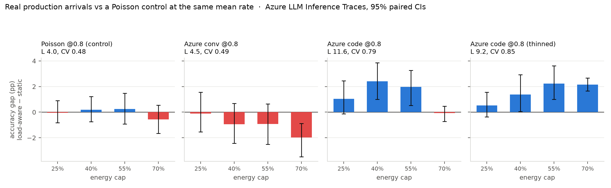

# E11 — does the E8 result survive a real production arrival process?

E8 concluded that load-aware reasoning allocation pays under **exogenous** load variability and not otherwise. That conditional is only useful if real traffic has such variability. Every arrival process in this project had been synthetic; this one is not.

Arrivals are taken from the [Azure LLM Inference Traces](https://github.com/Azure/AzurePublicDataset) (November 2023, production). **Only the arrival process is borrowed** — token counts and correctness still come from our own paired OTB measurements, which are what carry the energy and accuracy labels.

The trace is cluster-level and we simulate one A100, so the rate has to come down. Two transformations are reported, because they do opposite damage. **Dilation** (default) scales every timestamp by a constant: inter-arrival CV is invariant under time scaling, so the burst structure survives exactly — this is the model of *a proportionally smaller server seeing the same traffic shape*. **Thinning** keeps each arrival with probability `p`, as random load balancing does; it preserves absolute timescales but drives the process toward Poisson, destroying the very burstiness under test, and is included as a deliberately conservative lower bound. The control is synthetic Poisson at exactly the same mean rate, so between control and treatment only the **shape** of the arrival process differs.

## 1. How bursty is real traffic?

|arrival process|mean rate|concurrency L|load CV|utilisation|never (Wh)|always (Wh)|
|--|--|--|--|--|--|--|
|Poisson @0.8 (control)|0.8 req/s|4.0|0.48|0.98|40|56|
|Azure conv @0.8|0.8 req/s|4.5|0.49|0.98|38|57|
|Azure code @0.8|0.8 req/s|11.6|0.79|0.53|17|58|
|Azure code @0.8 (thinned)|0.8 req/s|9.2|0.85|0.54|20|56|

`load CV` is the time-weighted coefficient of variation of in-service concurrency under never-think — the quantity E8 identified as the thing that decides whether load-awareness has anything to exploit.

## 2. Does the advantage appear?

**Poisson @0.8 (control)**

|energy cap|random@rate (floor)|static threshold|load-aware (deployable)|oracle (ceiling)|gap, 95% CI|
|--|--|--|--|--|--|
|25%|0.8359 (4%)|0.8427 (1%)|0.8422 (2%)|0.8912 (8%)|**-0.05pp** [-0.83, +0.90]|
|40%|0.8382 (7%)|0.8456 (2%)|0.8474 (3%)|0.9039 (9%)|**+0.18pp** [-0.75, +1.22]|
|55%|0.8436 (14%)|0.8500 (3%)|0.8525 (4%)|0.9188 (11%)|**+0.25pp** [-0.92, +1.47]|
|70%|0.8568 (27%)|0.8789 (7%)|0.8733 (8%)|0.9337 (13%)|**-0.56pp** [-1.66, +0.54]|

**Azure conv @0.8**

|energy cap|random@rate (floor)|static threshold|load-aware (deployable)|oracle (ceiling)|gap, 95% CI|
|--|--|--|--|--|--|
|25%|0.8377 (5%)|0.8542 (3%)|0.8531 (3%)|0.8948 (8%)|**-0.11pp** [-1.53, +1.55]|
|40%|0.8434 (10%)|0.8682 (5%)|0.8587 (4%)|0.9125 (10%)|**-0.95pp** [-2.43, +0.69]|
|55%|0.8531 (19%)|0.8824 (7%)|0.8732 (7%)|0.9328 (12%)|**-0.92pp** [-2.50, +0.65]|
|70%|0.8728 (39%)|0.9215 (15%)|0.9017 (13%)|0.9469 (14%)|**-1.98pp** [-3.48, -0.88]|

**Azure code @0.8**

|energy cap|random@rate (floor)|static threshold|load-aware (deployable)|oracle (ceiling)|gap, 95% CI|
|--|--|--|--|--|--|
|25%|0.8370 (4%)|0.8458 (1%)|0.8562 (4%)|0.8875 (7%)|**+1.03pp** [-0.13, +2.44]|
|40%|0.8414 (8%)|0.8519 (2%)|0.8761 (7%)|0.9067 (9%)|**+2.42pp** [+1.00, +3.86]|
|55%|0.8470 (13%)|0.8677 (5%)|0.8874 (9%)|0.9311 (12%)|**+1.97pp** [+0.52, +3.27]|
|70%|0.8733 (39%)|0.9122 (13%)|0.9115 (14%)|0.9469 (14%)|**-0.08pp** [-0.73, +0.47]|

**Azure code @0.8 (thinned)**

|energy cap|random@rate (floor)|static threshold|load-aware (deployable)|oracle (ceiling)|gap, 95% CI|
|--|--|--|--|--|--|
|25%|0.8338 (2%)|0.8406 (1%)|0.8457 (2%)|0.8711 (5%)|**+0.52pp** [-0.37, +1.56]|
|40%|0.8369 (3%)|0.8448 (2%)|0.8586 (4%)|0.8858 (7%)|**+1.38pp** [+0.05, +2.93]|
|55%|0.8468 (13%)|0.8513 (3%)|0.8737 (7%)|0.9082 (9%)|**+2.23pp** [+1.01, +3.61]|
|70%|0.8637 (31%)|0.8857 (8%)|0.9071 (15%)|0.9285 (12%)|**+2.14pp** [+1.66, +2.66]|

## 3. Reading

**E8's conditional holds on real traffic, and the condition is workload type.** At an identical mean arrival rate of 0.8 req/s, the two production workloads produce completely different servers. Conversational traffic yields load CV 0.49 — indistinguishable from the Poisson control's 0.48 — and the load-aware policy does not merely fail to gain there, it loses (-0.95pp at the 40% cap). Code-completion traffic yields CV 0.79, and there the policy wins **+2.42pp** [+1.00, +3.86] at the same cap. Same router, same budget, same mean rate — the arrival *shape* decides.

**It survives the conservative transformation.** Thinning deliberately Poissonises the process, and the code trace still shows +2.23pp [+1.01, +3.61] at the 55% cap and +2.14pp at 70%. The effect is not an artefact of the rescaling method.

**A second finding, unplanned: burstiness makes the same work cheaper.** Never-think answers the identical 500 questions for **40 Wh** under Poisson arrivals but **17 Wh** under real code-completion arrivals — **2.4× less energy at the same mean request rate**, purely because clustered arrivals batch together and batching is where energy per token collapses. This is RQ1 restated at the level of the arrival process: not only is the price of a token set by concurrency, but the *traffic pattern itself* sets the concurrency. An operator smoothing traffic for latency reasons is buying that smoothness with energy.

**The honest limit.** Conversational burstiness is real at the cluster scale (Fano factor 20.6 over 60 s windows) but lives on a slower timescale than a 500-request evaluation window resolves. A router with a longer budget horizon might still exploit it; this experiment does not show that it can, and does not claim otherwise.

*Repro: `python scripts/e11_real_trace.py` (CPU). Traces are not committed — download `AzureLLMInferenceTrace_{conv,code}.csv` from the Azure repository into `data/azure/`.*
