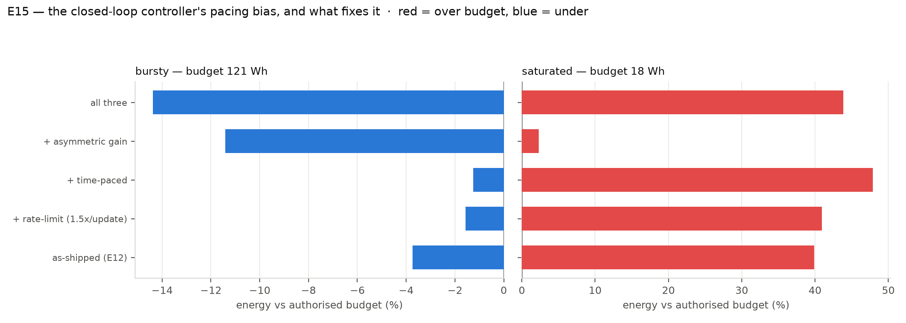

# E15 — why the closed-loop controller overspent, and what the simulator can and cannot say

E12 ran `BudgetController` against a real NVML energy meter on an A100 and it **failed** — +36.7% over budget on bursty traffic, +134.4% at saturation, worse than the offline tuning it was built to repair. The meter was not at fault: it agreed with Zeus to 0.0% on every run. The controller was.

## The mechanism, from E12's own pacing trace

```
n_done=10   spent 0.34 Wh   target 1.86 Wh   pace 0.305  ->  lambda 6.50e-04
n_done=29   spent 1.00 Wh   target 5.38 Wh   pace 0.301  ->  lambda 1.00e-08  (the FLOOR)
```

Within 29 of 200 requests the controller drove λ five orders of magnitude down to its clamp — think on everything. The second quartile of arrivals ran at an **82% think-rate**, and the run ended 37% over budget with λ back at 2.8e-02, far too late to matter.

**The diagnosis is a selection effect, not a measurement error.** The pacing signal is `committed / (budget × n_done/N)`, which assumes energy accrues in proportion to *completed requests*. It does not: completion order is correlated with cost, because short no-think requests finish first. Early in any window the realised spend is therefore **structurally** below the linear target, whether or not the policy is on track. The controller reads that as headroom and loosens. No improvement in metering can fix it.

## Three candidate fixes, tested in simulation

Same protocol as E8: 12 traces × 500 queries, budget = 1.5× never-think, matching E12's construction. `worst` is the worst single trace — a cap that holds on average but breaches half the time is not a cap.

**bursty** — authorised 120.5 Wh

|controller|energy (Wh)|vs budget|worst trace|breach rate|accuracy|think-rate|
|--|--|--|--|--|--|--|
|as-shipped (E12)|116.0|-3.7%|+18.1%|42%|0.8473|3.3%|
|+ rate-limit (1.5x/update)|118.6|-1.6%|+29.2%|42%|0.8483|3.4%|
|+ time-paced|119.0|-1.3%|+33.4%|33%|0.8475|3.4%|
|+ asymmetric gain|106.8|-11.4%|+10.2%|17%|0.8446|2.3%|
|all three|103.2|-14.4%|+2.7%|17%|0.8417|1.8%|

**saturated** — authorised 17.9 Wh

|controller|energy (Wh)|vs budget|worst trace|breach rate|accuracy|think-rate|
|--|--|--|--|--|--|--|
|as-shipped (E12)|25.1|+39.9%|+51.9%|100%|0.8617|6.9%|
|+ rate-limit (1.5x/update)|25.3|+40.9%|+52.0%|100%|0.8620|7.0%|
|+ time-paced|26.5|+47.9%|+62.7%|100%|0.8751|10.6%|
|+ asymmetric gain|18.3|+2.3%|+46.6%|42%|0.8441|2.2%|
|all three|25.8|+43.8%|+53.3%|100%|0.8705|7.5%|



## Reading — including what this experiment failed to establish

**The simulator does not reproduce the live failure, so it cannot validate the diagnosis.** As-shipped, the controller *under*-spends on bursty traffic here (−3.7% on average) where live it overspent by +36.7%. Whatever drove λ to its floor within 29 requests on the real server is not in this model — which is consistent with E9 and E13: the simulator under-predicts energy by 43% at load and does not model the preemption E13 measured, and those are precisely the conditions under which the controller broke. **The completion-order bias remains the best available explanation of the live trace, but it is not confirmed here.**

**Time-pacing does not help, which is evidence against the simplest version of that story.** If the completion-order bias were the whole mechanism, pacing against a clock would remove it. It does not — in either regime. So either the bias is not dominant in the simulator's dynamics, or it is not the dominant term live either.

**Only the asymmetric gain helps, and only partly.** Making the loosening gain a quarter of the tightening gain is the one variant that improves adherence in both regimes: on bursty it cuts the breach rate from 42% to 17% and the worst trace from +18.1% to +10.2%; at saturation it pulls the mean from +39.9% to +2.3%. But the worst trace at saturation is still +46.6% and 42% of traces still breach. **A cap that holds on average and breaches on four traces in ten is not a cap.**

**What this licenses saying.** That the shipped controller overspends is measured (E12). That an asymmetric gain is the most promising of three candidate repairs is a simulation result. That it *fixes* the live failure is **not** established, and the honest next step is to re-run E12 with it on real hardware rather than to report a fix that has only ever been tested against a model known to be wrong in the relevant regime.


*Repro: `python scripts/e15_controller_fix.py` (CPU).*
