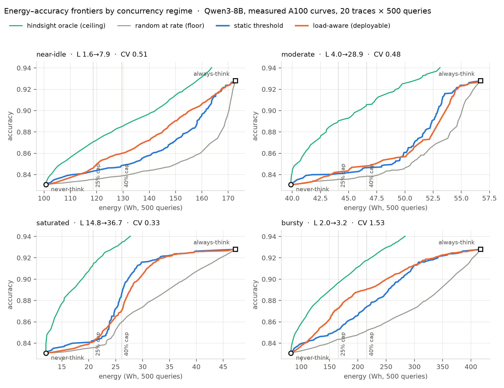
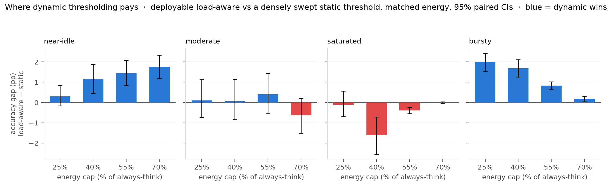
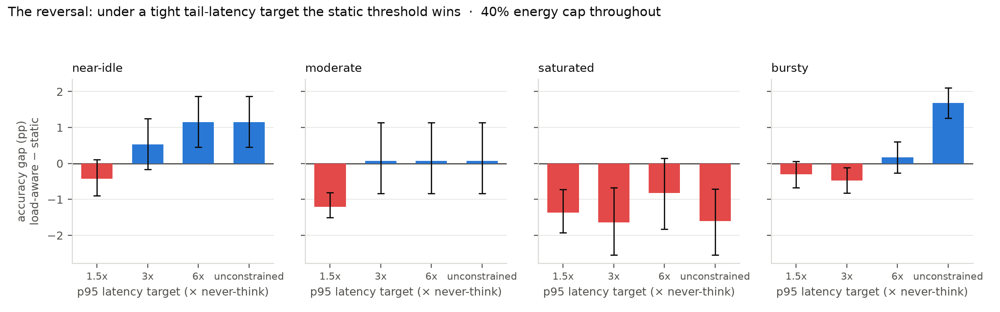
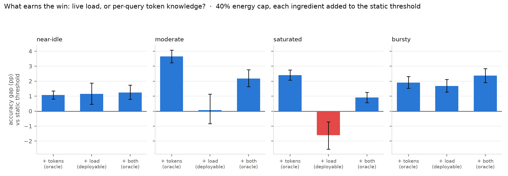

# E8 — the consolidated comparison: static vs dynamic thresholding, by concurrency regime

*One protocol, one results file. Supersedes the headline numbers in `results/e1`, `results/e3`, `results/e4` and the C2 column of `results/e5` (see `results/CORRECTIONS.md`). 20 held-out traces × 500 queries per operating point; identical arrival times and identical queries for every policy; accuracy read at matched energy. Static grid 231 thresholds, load-aware grids 347 / 287 — every family's grid is the image of its own dense score-space grid under its price map, so none is handicapped by grid resolution.*

## 0. The concurrency axis

Load is not set by hand — it emerges from arrivals versus service, so each policy's own thinking decisions feed back into the batch size it then sees. `L` is the time-weighted in-service concurrency over busy periods; it is reported for never-think → always-think to show the span each regime exercises on the measured J(L) curve.

|regime|arrival (hi/lo)|concurrency L never→always|load CV|utilisation|never (Wh)|always (Wh)|energy ratio|never +idle (Wh)|always +idle (Wh)|never acc|always acc|
|--|--|--|--|--|--|--|--|--|--|--|--|
|near-idle|0.2 / 0.2 req/s|1.6 → 7.9|0.51|0.62|100.7|172.8|1.7×|110.5|172.9|0.8306|0.9279|
|moderate|0.8 / 0.8 req/s|4.0 → 28.9|0.48|0.98|39.9|56.7|1.4×|40.0|56.7|0.8306|0.9279|
|saturated|3 / 3 req/s|14.8 → 36.7|0.33|1.00|12.0|47.3|3.9×|12.0|47.3|0.8306|0.9279|
|bursty|6 / 0.03 req/s|2.0 → 3.2|1.53|0.15|81.6|417.1|5.1×|153.8|436.3|0.8306|0.9279|

**The same 500 questions, answered identically, cost 8.4× more energy on a near-idle server than on a saturated one** (101 vs 12 Wh, never-think in both). Nothing about the work changed — only the queue. This is the same physics as the 42× J/token spread, stated at the level an operator bills at.

The `+idle` columns add the **measured 37.2 W idle draw** of an A100 with the weights resident (from the E6 replay, `results/validation/replay_summary.jsonl`) over the idle fraction of the wall clock. The simulator itself charges power only while the GPU is busy, which understates near-idle regimes most. It does not distort the policy comparisons: idle power is charged over wall-clock time, and a policy that thinks *more* keeps the GPU busy longer, so it idles *less* — correcting for it makes thinking look cheaper, not dearer.

## 1. E8a — allocation quality at matched energy

Every policy family gets its best feasible operating point at the cap, so the comparison is about *allocation*, not tuning luck. The floor (random at the same think-rate) and the ceiling (hindsight oracle) bracket what is achievable.

**near-idle**

|energy cap|random@rate (floor)|static threshold|load-aware **(deployable)**|load-aware + oracle tokens|oracle (ceiling)|deployable − static, 95% CI|
|--|--|--|--|--|--|--|
|25% (119 Wh)|0.8356 (5%)|0.8430 (2%)|0.8459 (3%)|0.8487 (5%)|0.8705 (5%)|**+0.30pp** [-0.17, +0.85]|
|40% (130 Wh)|0.8387 (8%)|0.8483 (3%)|0.8599 (5%)|0.8608 (7%)|0.8843 (7%)|**+1.16pp** [+0.46, +1.88]|
|55% (140 Wh)|0.8439 (13%)|0.8582 (4%)|0.8726 (8%)|0.8759 (10%)|0.8976 (9%)|**+1.44pp** [+0.84, +2.07]|
|70% (151 Wh)|0.8509 (21%)|0.8741 (7%)|0.8918 (11%)|0.8953 (14%)|0.9163 (11%)|**+1.77pp** [+1.18, +2.34]|

**moderate**

|energy cap|random@rate (floor)|static threshold|load-aware **(deployable)**|load-aware + oracle tokens|oracle (ceiling)|deployable − static, 95% CI|
|--|--|--|--|--|--|--|
|25% (44 Wh)|0.8355 (5%)|0.8409 (1%)|0.8420 (2%)|0.8566 (6%)|0.8903 (8%)|**+0.11pp** [-0.73, +1.16]|
|40% (47 Wh)|0.8384 (8%)|0.8464 (2%)|0.8471 (3%)|0.8682 (9%)|0.9056 (9%)|**+0.07pp** [-0.84, +1.14]|
|55% (49 Wh)|0.8441 (14%)|0.8515 (3%)|0.8555 (5%)|0.8820 (11%)|0.9190 (11%)|**+0.41pp** [-0.55, +1.43]|
|70% (52 Wh)|0.8585 (29%)|0.8788 (8%)|0.8725 (8%)|0.8939 (13%)|0.9329 (13%)|**-0.64pp** [-1.50, +0.21]|

**saturated**

|energy cap|random@rate (floor)|static threshold|load-aware **(deployable)**|load-aware + oracle tokens|oracle (ceiling)|deployable − static, 95% CI|
|--|--|--|--|--|--|--|
|25% (21 Wh)|0.8357 (5%)|0.8420 (2%)|0.8409 (2%)|0.8748 (10%)|0.9138 (10%)|**-0.11pp** [-0.69, +0.57]|
|40% (26 Wh)|0.8602 (30%)|0.8862 (8%)|0.8701 (7%)|0.8953 (14%)|0.9339 (13%)|**-1.61pp** [-2.54, -0.71]|
|55% (31 Wh)|0.8793 (49%)|0.9164 (16%)|0.9126 (16%)|0.9167 (19%)|0.9403 (14%)|**-0.38pp** [-0.55, -0.22]|
|70% (37 Wh)|0.8967 (66%)|0.9237 (25%)|0.9237 (26%)|0.9238 (34%)|0.9403 (14%)|**+0.00pp** [-0.04, +0.04]|

**bursty**

|energy cap|random@rate (floor)|static threshold|load-aware **(deployable)**|load-aware + oracle tokens|oracle (ceiling)|deployable − static, 95% CI|
|--|--|--|--|--|--|--|
|25% (165 Wh)|0.8435 (13%)|0.8528 (3%)|0.8727 (8%)|0.8774 (10%)|0.8964 (8%)|**+1.99pp** [+1.54, +2.44]|
|40% (216 Wh)|0.8518 (22%)|0.8738 (7%)|0.8905 (12%)|0.8974 (16%)|0.9174 (11%)|**+1.68pp** [+1.27, +2.11]|
|55% (266 Wh)|0.8641 (34%)|0.8964 (10%)|0.9047 (14%)|0.9115 (20%)|0.9339 (13%)|**+0.83pp** [+0.64, +1.02]|
|70% (316 Wh)|0.8790 (49%)|0.9159 (16%)|0.9177 (18%)|0.9197 (23%)|0.9403 (14%)|**+0.18pp** [+0.03, +0.32]|

Cells are `accuracy (think-rate)`. The CI is a bootstrap over the paired per-trace difference — both policies ran on the same traces, so the difference is paired.

**The headline column is `load-aware (deployable)`** — the rule with a *constant* Δtokens, which is what a live router can actually compute and what `src/router.py` ships. `load-aware + oracle tokens` is the same rule given per-query ground-truth token counts; it is an upper bound on what better token estimation could buy, not a claim. §3 separates the two ingredients directly.

## 2. E8b — the reversal under a tail-latency target

Same deployable load-aware rule as §1. Energy cap held at 40% throughout; a p95 SLO is added alongside it, expressed as a multiple of the never-think p95 in that regime.

|regime|p95 target|static acc|static p95|load-aware acc|load-aware p95|gap, 95% CI|
|--|--|--|--|--|--|--|
|near-idle|1.5x|0.8483|18 s|0.8441|21 s|-0.43pp [-0.90, +0.11]|
|near-idle|3x|0.8483|18 s|0.8537|39 s|+0.53pp [-0.17, +1.26]|
|near-idle|6x|0.8483|18 s|0.8599|49 s|+1.16pp [+0.46, +1.88]|
|near-idle|unconstrained|0.8483|18 s|0.8599|49 s|+1.16pp [+0.46, +1.88]|
|moderate|1.5x|0.8464|17 s|0.8343|15 s|-1.21pp [-1.51, -0.81]|
|moderate|3x|0.8464|17 s|0.8471|37 s|+0.07pp [-0.84, +1.14]|
|moderate|6x|0.8464|17 s|0.8471|37 s|+0.07pp [-0.84, +1.14]|
|moderate|unconstrained|0.8464|17 s|0.8471|37 s|+0.07pp [-0.84, +1.14]|
|saturated|1.5x|0.8528|22 s|0.8391|23 s|-1.37pp [-1.93, -0.73]|
|saturated|3x|0.8660|45 s|0.8497|45 s|-1.64pp [-2.55, -0.68]|
|saturated|6x|0.8783|84 s|0.8701|82 s|-0.82pp [-1.83, +0.15]|
|saturated|unconstrained|0.8862|119 s|0.8701|82 s|-1.61pp [-2.54, -0.71]|
|bursty|1.5x|0.8543|21 s|0.8512|21 s|-0.31pp [-0.68, +0.06]|
|bursty|3x|0.8678|42 s|0.8630|42 s|-0.48pp [-0.83, -0.11]|
|bursty|6x|0.8738|61 s|0.8754|84 s|+0.17pp [-0.26, +0.60]|
|bursty|unconstrained|0.8738|61 s|0.8905|123 s|+1.68pp [+1.27, +2.11]|

## 3. E8d — what earns the win: live load, or per-query token knowledge?

The full rule `score > λ·J(L)·Δtokens(q)` uses two things a plain threshold does not: the **live load** `L`, and the **per-query token count** `Δtokens(q)`. Δtokens is *not observable before generating* — the simulator reads it from the paired dataset, a live router cannot — so a comparison that grants it to one side only is both unfair to the baseline and undeployable. Adding each ingredient separately to the static threshold settles which one carries the result, and therefore whether the deployable router keeps it.

`load-aware-const` replaces Δtokens(q) with the constant E[Δtokens] = 2370 tokens — load-aware, per-query token-blind. It is exactly what `src/router.py` ships by default.

|regime|cap|rule|accuracy|think-rate|p95|gap vs static, 95% CI|
|--|--|--|--|--|--|--|
|near-idle|25%|static threshold (baseline)|0.8430|2%|16 s|—|
|near-idle|25%|+ per-query tokens (token proxy)|0.8489|5%|23 s|+0.60pp [+0.40, +0.78]|
|near-idle|25%|+ live load — **deployable**|0.8459|3%|24 s|+0.30pp [-0.17, +0.85]|
|near-idle|25%|+ both (oracle tokens)|0.8487|5%|23 s|+0.58pp [+0.27, +0.92]|
|near-idle|40%|static threshold (baseline)|0.8483|3%|18 s|—|
|near-idle|40%|+ per-query tokens (token proxy)|0.8591|7%|39 s|+1.08pp [+0.81, +1.34]|
|near-idle|40%|+ live load — **deployable**|0.8599|5%|49 s|+1.16pp [+0.46, +1.88]|
|near-idle|40%|+ both (oracle tokens)|0.8608|7%|38 s|+1.25pp [+0.79, +1.75]|
|moderate|25%|static threshold (baseline)|0.8409|1%|16 s|—|
|moderate|25%|+ per-query tokens (token proxy)|0.8658|9%|50 s|+2.49pp [+2.15, +2.83]|
|moderate|25%|+ live load — **deployable**|0.8420|2%|31 s|+0.11pp [-0.73, +1.16]|
|moderate|25%|+ both (oracle tokens)|0.8566|6%|33 s|+1.58pp [+1.16, +2.08]|
|moderate|40%|static threshold (baseline)|0.8464|2%|17 s|—|
|moderate|40%|+ per-query tokens (token proxy)|0.8829|11%|67 s|+3.65pp [+3.23, +4.08]|
|moderate|40%|+ live load — **deployable**|0.8471|3%|37 s|+0.07pp [-0.84, +1.14]|
|moderate|40%|+ both (oracle tokens)|0.8682|9%|50 s|+2.18pp [+1.64, +2.76]|
|saturated|25%|static threshold (baseline)|0.8420|2%|17 s|—|
|saturated|25%|+ per-query tokens (token proxy)|0.8914|12%|88 s|+4.94pp [+4.40, +5.50]|
|saturated|25%|+ live load — **deployable**|0.8409|2%|26 s|-0.11pp [-0.69, +0.57]|
|saturated|25%|+ both (oracle tokens)|0.8748|10%|64 s|+3.28pp [+2.75, +3.83]|
|saturated|40%|static threshold (baseline)|0.8862|8%|119 s|—|
|saturated|40%|+ per-query tokens (token proxy)|0.9102|16%|149 s|+2.40pp [+2.07, +2.75]|
|saturated|40%|+ live load — **deployable**|0.8701|7%|82 s|-1.61pp [-2.54, -0.71]|
|saturated|40%|+ both (oracle tokens)|0.8953|14%|110 s|+0.91pp [+0.57, +1.25]|
|bursty|25%|static threshold (baseline)|0.8528|3%|20 s|—|
|bursty|25%|+ per-query tokens (token proxy)|0.8708|9%|52 s|+1.81pp [+1.47, +2.14]|
|bursty|25%|+ live load — **deployable**|0.8727|8%|75 s|+1.99pp [+1.54, +2.44]|
|bursty|25%|+ both (oracle tokens)|0.8774|10%|65 s|+2.46pp [+2.02, +2.89]|
|bursty|40%|static threshold (baseline)|0.8738|7%|61 s|—|
|bursty|40%|+ per-query tokens (token proxy)|0.8928|13%|75 s|+1.91pp [+1.53, +2.31]|
|bursty|40%|+ live load — **deployable**|0.8905|12%|123 s|+1.68pp [+1.27, +2.11]|
|bursty|40%|+ both (oracle tokens)|0.8974|16%|100 s|+2.37pp [+1.91, +2.85]|

## 4. E8c — deployment: tuned offline, does it hold the cap?

Each policy is tuned on 5 *historical* traces and then deployed on the 20 held-out ones — the realistic procedure. `vs cap` is the realised energy against the authorised budget; `breach` is the fraction of traces that exceeded it. `load-aware+feedback` needs no offline tuning: it adapts λ against the meter, counting energy already committed by in-flight requests.

|regime|cap|policy|accuracy|energy (Wh)|vs cap|breach rate|think-rate|p95|
|--|--|--|--|--|--|--|--|--|
|near-idle|25%|static-tau|0.8447|121.4|+2.3%|60%|2%|16 s|
|near-idle|25%|load-aware|0.8469|116.8|-1.6%|35%|4%|21 s|
|near-idle|25%|load-aware-const|0.8402|113.4|-4.4%|25%|2%|19 s|
|near-idle|25%|random@rate|0.8341|114.3|-3.7%|25%|3%|16 s|
|near-idle|25%|load-aware+feedback|0.8518|120.1|+1.2%|65%|5%|27 s|
|near-idle|40%|static-tau|0.8506|133.3|+2.9%|70%|3%|19 s|
|near-idle|40%|load-aware|0.8602|128.9|-0.5%|30%|7%|37 s|
|near-idle|40%|load-aware-const|0.8604|130.4|+0.7%|45%|5%|50 s|
|near-idle|40%|random@rate|0.8374|124.3|-4.1%|30%|7%|19 s|
|near-idle|40%|load-aware+feedback|0.8685|131.0|+1.1%|65%|9%|55 s|
|moderate|25%|static-tau|0.8409|44.0|-0.2%|50%|1%|16 s|
|moderate|25%|load-aware|0.8598|44.6|+1.3%|60%|7%|37 s|
|moderate|25%|load-aware-const|0.8339|41.8|-5.1%|20%|1%|15 s|
|moderate|25%|random@rate|0.8436|48.7|+10.6%|85%|13%|25 s|
|moderate|25%|load-aware+feedback|0.8582|47.2|+7.0%|80%|6%|39 s|
|moderate|40%|static-tau|0.8490|48.1|+3.3%|55%|3%|19 s|
|moderate|40%|load-aware|0.8647|45.3|-2.9%|25%|8%|44 s|
|moderate|40%|load-aware-const|0.8340|41.8|-10.3%|20%|1%|15 s|
|moderate|40%|random@rate|0.8441|48.8|+4.7%|85%|14%|26 s|
|moderate|40%|load-aware+feedback|0.8728|51.0|+9.4%|100%|10%|65 s|
|saturated|25%|static-tau|0.8420|20.5|-1.5%|45%|2%|17 s|
|saturated|25%|load-aware|0.8762|21.2|+1.8%|65%|10%|66 s|
|saturated|25%|load-aware-const|0.8422|21.1|+1.3%|65%|2%|27 s|
|saturated|25%|random@rate|0.8387|23.1|+10.7%|80%|8%|23 s|
|saturated|25%|load-aware+feedback|0.8848|27.3|+31.1%|100%|15%|116 s|
|saturated|40%|static-tau|0.8992|27.2|+4.2%|75%|11%|156 s|
|saturated|40%|load-aware|0.9015|27.2|+4.2%|75%|15%|129 s|
|saturated|40%|load-aware-const|0.8766|26.5|+1.5%|45%|8%|98 s|
|saturated|40%|random@rate|0.8559|25.4|-2.7%|35%|26%|61 s|
|saturated|40%|load-aware+feedback|0.9015|31.8|+21.7%|100%|31%|194 s|
|bursty|25%|static-tau|0.8582|178.0|+7.5%|65%|4%|26 s|
|bursty|25%|load-aware|0.8737|157.1|-5.1%|30%|9%|59 s|
|bursty|25%|load-aware-const|0.8679|155.4|-6.1%|20%|7%|59 s|
|bursty|25%|random@rate|0.8419|157.3|-4.9%|35%|11%|23 s|
|bursty|25%|load-aware+feedback|0.8494|149.4|-9.7%|25%|11%|34 s|
|bursty|40%|static-tau|0.8741|215.8|+0.0%|45%|7%|62 s|
|bursty|40%|load-aware|0.8950|208.9|-3.2%|25%|15%|98 s|
|bursty|40%|load-aware-const|0.8905|215.8|+0.0%|45%|12%|123 s|
|bursty|40%|random@rate|0.8487|203.3|-5.8%|30%|19%|33 s|
|bursty|40%|load-aware+feedback|0.8636|195.4|-9.4%|30%|19%|65 s|

*Repro: `python scripts/e8_consolidated.py` (CPU, a few minutes). Raw per-row numbers in `e8_rows.json`.*
